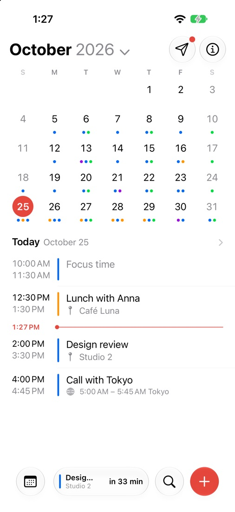
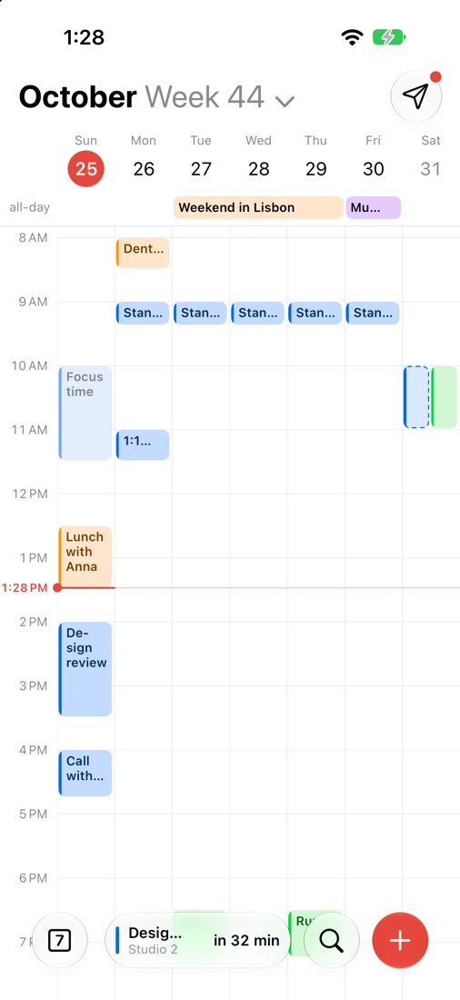
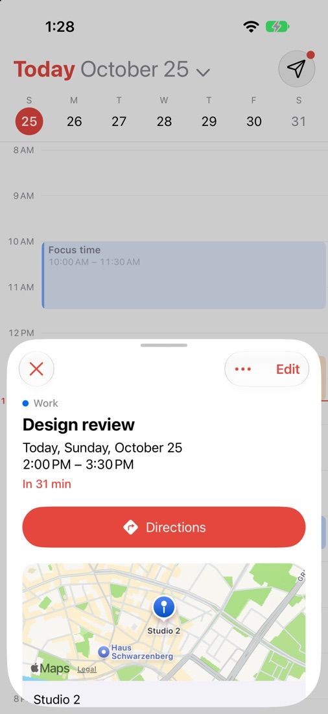
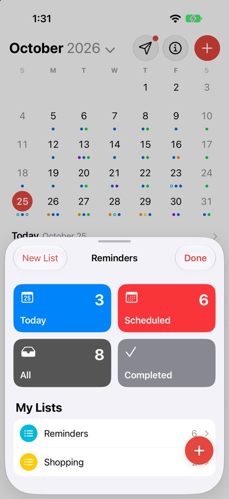

<p align="center"></p>

<h1 align="center">Day</h1>
<p align="center"><strong>Your day, at a glance.</strong><br>A calm calendar for iPhone, iPad, Mac and Apple Watch that shows the calendars you already have, and your Reminders.</p>
<p align="center"><a href="https://apps.apple.com/app/day-calendar/id6822896434">App Store</a> · <a href="https://enrzh.github.io/Day/">Website</a> · <a href="https://enrzh.github.io/Day/en/privacy.html">Privacy</a> · <a href="https://enrzh.github.io/Day/privacy.html">Datenschutz</a> · <a href="CHANGELOG.md">Changelog</a> · <a href="mailto:getaiityapp+day@gmail.com">Contact</a></p>

<p align="center">
  
  
  
  
</p>

## What Day does

Day reads and writes the calendars on your device (iCloud, Google, Exchange and others), so what you change in Day is what every other app shows. There is no Day account and no server of its own, and nothing is tracked.

- **Views:** Day, 3 Days, Week, Month and Year, with a pinch to move between them.
- **Quick Add:** type or say a sentence such as "Lunch with Anna tomorrow at 1pm", and check what Day understood before it's added. Dates and times are read on the device; Apple Intelligence or an optional on-device model finds more.
- **Reminders:** Apple's Reminders with a date show in the calendar. Tick them off, drag them, and keep lists as cards, in groups of your own.
- **Up Next:** widgets (Home Screen and Lock Screen), a Live Activity with a countdown, and Control Center and Action button controls.
- **iPad and Mac:** bigger layouts, a menu bar, keyboard shortcuts and popovers on the Mac.
- **Apple Watch:** the agenda with event details, and complications.
- **Places and travel:** places from Apple Maps, leave-by alerts, and Join links that open in the right app.
- **Languages:** English, German, Simplified and Traditional Chinese, Japanese, French, Spanish, Brazilian Portuguese, Italian and Korean.

Requires iOS 18 or macOS 15 or later.

## About this repository

This is the public website and privacy policy for Day. The app itself lives in a separate private repository; this is not an open-source distribution of the application.

GitHub Pages serves plain HTML and CSS from the root of `main`. No framework, build step, tracking scripts or external fonts.

| Path | What |
| --- | --- |
| `index.html`, `privacy.html` | The German site and privacy policy (the site root) |
| `en/index.html`, `en/privacy.html` | The English site and privacy policy |
| `site.css` | One stylesheet for every page, light and dark |
| `images/` | The icon and the screenshots: iPhone at 506 × 1100, iPad at 1100 wide, Mac at 1600 wide, as JPEG |

### Preview

```sh
python3 -m http.server 8080
```

Then open <http://localhost:8080/> (German) or <http://localhost:8080/en/> (English).

### Keeping it right

- Every page exists in German and English. Change both together.
- Keep the privacy policy aligned with what the app does, and keep both policy URLs (`/privacy.html` and `/en/privacy.html`) working: the App Store listing points to them.
- Describe only what the published version of the app does.
- New screenshots come from the app's demo calendar. Resize to the sizes above, as JPEG, and keep the file names.

Part of [aiity](https://aiity.de) · [hAiity](https://enrzh.github.io/hAiity/)
